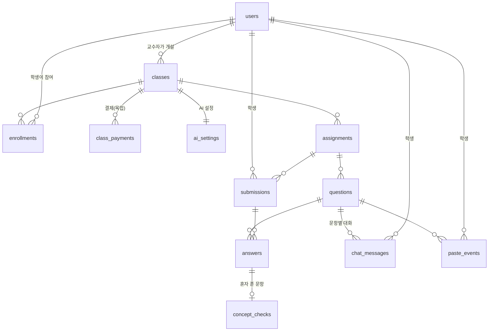

# DB 스키마 설계서

> 상태: **초안** — [결정 필요](#결정-필요) 항목이 정해지면 확정한다.
> SQLAlchemy 2.0 모델로 구현(`backend/app/models/`). 개발은 SQLite, 이후 `DATABASE_URL`만 바꿔 PostgreSQL로 전환.
> 한 번에 전부 만들지 말고, 기능 PR마다 필요한 테이블만 추가한다.

## 공통 규칙
- 모든 테이블: `id` (INTEGER PK, 자동 증가), `created_at`. 수정되는 테이블은 `updated_at`도.
- 상태·종류 값은 **Python Enum**으로 정의하고 DB에는 문자열로 저장한다.
- 시각은 UTC로 저장하고 화면에서 한국 시간으로 보여 준다.
- 금액은 **정수(원 단위)**. 부동소수 금지.
- 개인정보 최소화: 붙여넣기 **내용**은 어디에도 저장하지 않는다(불변식 I5, [../conventions/ai-code-trust.md](../conventions/ai-code-trust.md)).

## Enum
```python
class Role(StrEnum):            TEACHER, STUDENT
class PlanCode(StrEnum):        STARTER, PRO, MASTER
class SubjectType(StrEnum):     MATH, PROGRAMMING, WRITING, CONCEPT
class QuestionType(StrEnum):    MULTIPLE_CHOICE, SHORT_ANSWER, ESSAY
class GradingMode(StrEnum):     AUTO, MANUAL           # 객관식·단답형 = AUTO, 서술형 = MANUAL
class SubmissionStatus(StrEnum): IN_PROGRESS, SUBMITTED
class ChatRole(StrEnum):        STUDENT, ASSISTANT
class ResponseMode(StrEnum):    NEXT_STEP, HINT_ONLY, ASK_ATTEMPT, OFF_TOPIC, USAGE_LIMIT
class PasteField(StrEnum):      ANSWER, CHAT, CONCEPT_CHECK
```

## ERD


## 테이블

### users
| 컬럼 | 타입 | 설명 |
|---|---|---|
| id | PK | |
| email | VARCHAR UNIQUE | 로그인 ID |
| password_hash | VARCHAR | bcrypt |
| name | VARCHAR | |
| role | VARCHAR | Role |
| created_at | DATETIME | |

### classes
| 컬럼 | 타입 | 설명 |
|---|---|---|
| id | PK | |
| teacher_id | FK → users | 교수자만 |
| name | VARCHAR | 과목명 |
| invite_code | VARCHAR UNIQUE | 예: `TG-4821`. 충돌 시 재발급 |
| student_limit | INTEGER | 학생 수 상한 |
| plan | VARCHAR | PlanCode |
| starts_at | DATETIME | 개설 시각 |
| expires_at | DATETIME | 최대 `starts_at + 1년`. 연장 결제 시 늘어남 |
| created_at, updated_at | DATETIME | |

- 참여 시 확인: `expires_at > now`, 현재 참여 학생 수 < `student_limit`.

### class_payments (결제 목업)
| 컬럼 | 타입 | 설명 |
|---|---|---|
| id | PK | |
| class_id | FK → classes | |
| plan | VARCHAR | PlanCode |
| student_count | INTEGER | 결제 기준 학생 수 |
| amount | INTEGER | 원 단위. 요금 계산식은 D1 |
| period_start, period_end | DATETIME | 이용 기간 |
| kind | VARCHAR | `NEW` · `EXTEND` |
| created_at | DATETIME | |

- 실제 PG 연동 없음. "결제하기"를 누르면 행만 추가한다.

### enrollments
| 컬럼 | 타입 | 설명 |
|---|---|---|
| id | PK | |
| class_id | FK → classes | |
| student_id | FK → users | |
| created_at | DATETIME | 참여 시각 |

- UNIQUE(`class_id`, `student_id`)

### ai_settings
| 컬럼 | 타입 | 설명 |
|---|---|---|
| id | PK | |
| class_id | FK → classes UNIQUE | 클래스당 1개 (D2) |
| subject_type | VARCHAR | SubjectType |
| hints_enabled | BOOLEAN | |
| max_hint_steps | INTEGER | 0–5 |
| concept_check_enabled | BOOLEAN | 혼자 푼 문항 제출 전 개념 확인 |
| usage_limit | INTEGER | 학생별 AI 사용량 상한 (단위 D3) |
| created_at, updated_at | DATETIME | |

- 시스템 프롬프트는 저장하지 않고 요청마다 이 값으로 만든다(`services/prompt_builder.py`).

### assignments
| 컬럼 | 타입 | 설명 |
|---|---|---|
| id | PK | |
| class_id | FK → classes | |
| title | VARCHAR | |
| due_at | DATETIME nullable | 마감 |
| published | BOOLEAN | 학생에게 공개 여부 |
| created_at, updated_at | DATETIME | |

### questions
| 컬럼 | 타입 | 설명 |
|---|---|---|
| id | PK | |
| assignment_id | FK → assignments | |
| position | INTEGER | 문항 순서 |
| type | VARCHAR | QuestionType |
| prompt | TEXT | 문제 |
| choices | JSON nullable | 객관식 선택지 배열 |
| answer | TEXT nullable | 정답(객관식은 선택지 번호). 서술형은 NULL |
| accepted_answers | JSON nullable | 단답형에서 함께 인정할 표기 |
| points | INTEGER | 배점 |
| grading_mode | VARCHAR | GradingMode |
| rubric | TEXT nullable | 서술형 채점 기준 |
| model_answer | TEXT nullable | 서술형 모범 답안. **학생 API 응답에 절대 포함 금지** |

- `answer`·`accepted_answers`·`model_answer`는 학생용 API 응답 스키마에서 제외한다.

### submissions
| 컬럼 | 타입 | 설명 |
|---|---|---|
| id | PK | |
| assignment_id | FK → assignments | |
| student_id | FK → users | |
| status | VARCHAR | SubmissionStatus |
| submitted_at | DATETIME nullable | |
| created_at | DATETIME | |

- UNIQUE(`assignment_id`, `student_id`)

### answers
| 컬럼 | 타입 | 설명 |
|---|---|---|
| id | PK | |
| submission_id | FK → submissions | |
| question_id | FK → questions | |
| content | TEXT | 학생 답 |
| is_correct | BOOLEAN nullable | 자동 채점 결과. 서술형은 NULL |
| score | INTEGER nullable | 서술형은 교수자 확정 전 NULL |
| feedback | TEXT nullable | 교수자 코멘트 |
| graded_by | FK → users nullable | 서술형 채점한 교수자 |
| graded_at | DATETIME nullable | |
| hint_steps_used | INTEGER | 제출 시점까지 받은 힌트 단계 수 (대시보드용) |
| solved_alone | BOOLEAN | 혼자 푼 문항 여부 (판단 기준 D4) |
| created_at, updated_at | DATETIME | |

- UNIQUE(`submission_id`, `question_id`)

### concept_checks
| 컬럼 | 타입 | 설명 |
|---|---|---|
| id | PK | |
| answer_id | FK → answers UNIQUE | |
| question_text | TEXT | AI가 한 개념 확인 질문 |
| reply | TEXT | 학생 답변 |
| created_at | DATETIME | |

- 점수에 반영하지 않는다. 교수자 대시보드에 표시.

### chat_messages
| 컬럼 | 타입 | 설명 |
|---|---|---|
| id | PK | |
| student_id | FK → users | |
| question_id | FK → questions | 문항별 대화 (D5) |
| role | VARCHAR | ChatRole |
| content | TEXT | |
| response_mode | VARCHAR nullable | ASSISTANT 메시지에만. ResponseMode |
| is_learning_context | BOOLEAN nullable | STUDENT 메시지에만. 분류 결과 |
| requests_complete_answer | BOOLEAN nullable | 〃 |
| has_self_attempt_evidence | BOOLEAN nullable | 〃 |
| uncertain | BOOLEAN nullable | 〃 |
| confidence | FLOAT nullable | 〃 |
| hint_step | INTEGER nullable | 이 응답으로 열린 힌트 단계 |
| created_at | DATETIME | |

- 인덱스: (`student_id`, `question_id`, `created_at`), (`student_id`, `created_at`) — 사용량 집계용.
- 분류 결과를 남기는 이유: 대시보드 집계 + NLP 팀 모델 평가 데이터.

### paste_events
| 컬럼 | 타입 | 설명 |
|---|---|---|
| id | PK | |
| student_id | FK → users | |
| question_id | FK → questions | |
| field | VARCHAR | PasteField |
| length | INTEGER | 붙여넣은 글자 수 |
| pasted_at | DATETIME | 클라이언트 기준 시각 |
| created_at | DATETIME | 서버 수신 시각 |

- **내용 컬럼 없음** (불변식 I5).

## 사용량 상한
별도 테이블 없이 `chat_messages`에서 집계한다(예: 오늘 이 학생의 `role=STUDENT` 메시지 수). 단위가 정해지면(D3) 확정.

## 결정 필요
| # | 항목 | 선택지 | 제안 |
|---|---|---|---|
| D1 | Starter / Pro / Master 차이와 요금 계산 | 학생 수 상한? AI 사용량 상한? 기능 차이? | 상한 학생 수만 다르게(예: 30 / 100 / 300), 요금 = 단가 × 학생 수 |
| D2 | AI 설정 단위 | 클래스마다 / 과제마다 | 클래스마다 (명세 "과목별") |
| D3 | AI 사용량 상한 단위 | 하루 메시지 수 / 과제당 메시지 수 / 토큰 | 하루 메시지 수 (집계 쉽고 학생에게 설명하기 쉬움) |
| D4 | "혼자 푼 문항" 판단 | 그 문항에서 AI 채팅 0회 / 힌트 0단계 | 힌트 0단계 (v2 시안과 같음) |
| D5 | 대화 단위 | 문항별 / 과제 전체 | 문항별 (v2 시안과 같음, 힌트 단계 관리가 쉬움) |
