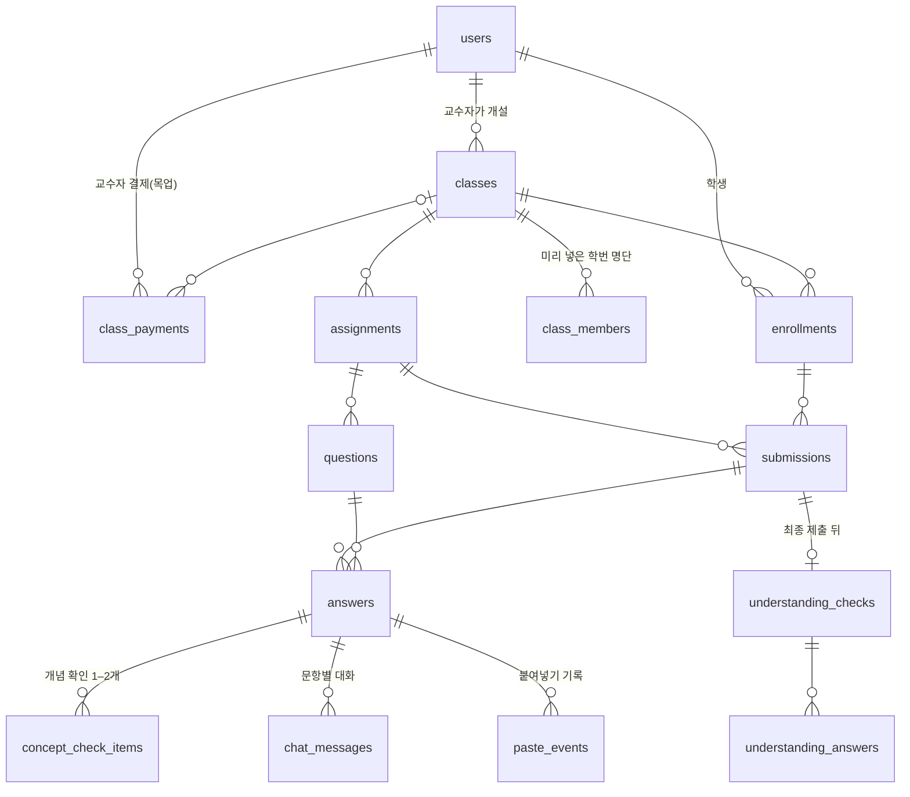

# DB 스키마 설계서

> 상태: **초안 v3** — 화면시안 v3 · [../spec/api-contract.md](../spec/api-contract.md)(v3) · `frontend/src/api/*.ts` 타입 · [scope.md](scope.md) 기준. 2026-11-17 결정 반영.
> SQLAlchemy 2.0 모델로 구현(`backend/app/models/`). 개발은 SQLite, 이후 `DATABASE_URL`만 바꿔 PostgreSQL로 전환.
> 한 번에 전부 만들지 말고, 기능 PR마다 필요한 테이블만 추가한다.

## 공통 규칙
- 모든 테이블: `seq` (INTEGER PK, 자동 증가), `created_at`. 수정되는 테이블은 `updated_at`도.
  - FK 컬럼 이름(`teacher_id`, `class_id`, `student_id` …)은 그대로 두고, 가리키는 테이블의 `seq`를 뜻한다. API 응답 필드도 `seq`(숫자)로 같게 쓴다.
  - 사람이 입력하는 값은 PK가 아니다: 로그인 ID = `users.email`, 학번 = `enrollments.student_no`.
- **시각은 모두 KST(+09:00)**. 시간대 정보를 포함해 저장한다(예: `2026-11-17T17:30:00+09:00`). API도 같은 형식으로 주고받는다.
  - 서버에서 현재 시각은 `now_kst()` 하나로만 만든다(`datetime.now(ZoneInfo("Asia/Seoul"))`).
  - SQLite는 시간대를 저장하지 못하므로 `db/types.py`에 KST 전용 컬럼 타입(`KstDateTime`)을 두고, 모든 시각 컬럼은 이 타입을 쓴다. PostgreSQL로 옮기면 `timestamptz`로 매핑한다.
- 상태·종류 값은 **Python Enum**(대문자 문자열)으로 정의하고 DB에는 문자열로 저장한다.
- 금액은 **정수(원 단위)**. 부동소수 금지.
- 구조가 자주 바뀌는 묶음 값(AI 정책, 테스트 케이스, 선택지 등)은 **JSON 컬럼**에 두고, 읽고 쓸 때 Pydantic 모델로 검증한다.
- **붙여넣기 내용은 어디에도 저장하지 않는다** (불변식 I5, [../conventions/ai-code-trust.md](../conventions/ai-code-trust.md)).
- **학생에게 보내면 안 되는 컬럼**(정답·모범 답안·숨김 테스트·결과 공개 전 정오·점수·참고 신호)은 각 테이블에 🔒로 표시했다. 학생용 응답 스키마에서 빼야 한다.

## Enum
```python
class Role(StrEnum):             TEACHER, STUDENT
class PlanCode(StrEnum):         SMALL, MEDIUM, LARGE            # 학생 50 / 100 / 200명
class PaymentKind(StrEnum):      NEW, EXTEND
class JoinMode(StrEnum):         APPROVAL, OPEN                  # 명단 없는 학생: 참여 요청 / 바로 입장
class EnrollmentStatus(StrEnum): PENDING, APPROVED, REJECTED, REMOVED
class Language(StrEnum):         PYTHON, JAVA, C, JAVASCRIPT     # 여러 언어 지원. 실행기는 현재 PYTHON만 구현
class QuestionType(StrEnum):     MULTIPLE_CHOICE, SHORT_ANSWER, CODE, PROJECT
                                 # 객관식 퀴즈 / 출력 예측 / 코드 작성(테스트 실행) / 간단 제작(교수자 채점)
class HintMode(StrEnum):         NONE, CONCEPT, STEP, EARNED
class HintPenalty(StrEnum):      NONE, PER_STEP, PRACTICE
class PromptMode(StrEnum):       FORM, CUSTOM
class AnswerStatus(StrEnum):     DRAFT, AWAITING_CHECK, SUBMITTED
class ConceptStatus(StrEnum):    CONFIRMED, NEEDS_WORK, UNCLEAR
class Confidence(StrEnum):       SURE, UNSURE, DONT_KNOW
class ChatRole(StrEnum):         STUDENT, ASSISTANT
class ResponseMode(StrEnum):     NEXT_STEP, HINT_ONLY, ASK_ATTEMPT, OFF_TOPIC, USAGE_LIMIT, OFFER_CHOICES
class HelpChoice(StrEnum):       FIRST_HINT, FEEDBACK, ORIGINAL
class PasteField(StrEnum):       ANSWER, CHAT, CONCEPT_CHECK
```
> `ResponseMode`는 지금 `backend/app/services/policy.py`가 소문자이고 `OFFER_CHOICES`가 없다. 채팅 API 구현 PR에서 맞춘다(api-contract 결정 B).

## ERD


---

## 테이블

### users
교수자와 학생 모두. **초기에는 학생 가입 화면이 없고**, 학생은 수업 코드 + 학번으로 입장할 때 계정이 만들어진다. 고도화 단계에서 학생 단독 가입을 열 때 테이블은 그대로 쓴다.

| 컬럼 | 타입 | 설명 |
|---|---|---|
| seq | PK | |
| role | VARCHAR | Role |
| email | VARCHAR UNIQUE nullable | 로그인 ID. 수업 코드로 입장한 학생은 NULL |
| password_hash | VARCHAR nullable | 아래 [비밀번호 저장](#비밀번호-저장). 수업 코드로 입장한 학생은 NULL |
| name | VARCHAR | 교수자: 이름 / 수업 코드 학생: 처음 입장한 학번 |
| login_at | KstDateTime nullable | **가장 최근 로그인 시각.** 교수자 로그인 성공 시, 학생은 수업 입장(토큰 발급) 시 갱신 |
| created_at, updated_at | KstDateTime | |

- 교수자 가입: `email`·`password_hash` 필수, `role = TEACHER`.
- 수업 코드 입장: 유효한 학생 토큰을 가지고 다른 수업에 들어오면 **같은 학생 계정을 재사용**하고, 토큰이 없으면 새 학생 계정을 만든다.

#### 비밀번호 저장
- **PBKDF2-HMAC-SHA512** (Python 표준 라이브러리 `hashlib.pbkdf2_hmac`), 반복 200,000회, 사용자마다 무작위 salt 16바이트.
- 저장 형식: `pbkdf2_sha512$200000$<salt base64>$<hash base64>` — 반복 횟수를 나중에 늘려도 기존 값을 그대로 검증할 수 있다.
- 비교는 `hmac.compare_digest`로 한다(시간차 공격 방지). 비밀번호 원문은 로그에도 남기지 않는다.

### classes
| 컬럼 | 타입 | 설명 |
|---|---|---|
| seq | PK | |
| teacher_id | FK → users | `role = TEACHER`만 |
| name | VARCHAR | 클래스 이름 (예: 프로그래밍 기초 1분반) |
| invite_code | VARCHAR UNIQUE | 수업 코드. 예: `TG-4821`. 충돌 시 재발급 |
| plan | VARCHAR | PlanCode (지금 적용 중인 요금제) |
| student_limit | INTEGER | 지금 적용 중인 학생 수 상한. **교수자가 직접 입력하지 않고** 개설·연장 결제 때 요금제 값을 복사해 둔다(요금제 표가 나중에 바뀌어도 그 시점 값이 남음) |
| join_mode | VARCHAR | JoinMode. 기본 `APPROVAL` |
| ai_defaults | JSON | 새 과제에 미리 채울 AI 정책([AiPolicy](#aipolicy-json)). 이미 만든 과제에는 영향 없음 |
| starts_at | KstDateTime | **이용 시작 시각.** 교수자가 개설할 때 시작 날짜를 고르고(오늘 이후), 그날 00:00 KST로 저장 |
| expires_at | KstDateTime | `starts_at + 1년`. 연장 결제 시 1년씩 늘어남 |
| created_at, updated_at | KstDateTime | `created_at` = 개설(결제) 시각. `starts_at`보다 앞설 수 있음 |

- 개설 시점과 이용 시작 시점은 다를 수 있다: 예) 11/17 개설, 시작일 2027-03-02 → `starts_at = 2027-03-02T00:00:00+09:00`, `expires_at = 2028-03-02T00:00:00+09:00`.
- **시작 전**(`now_kst() < starts_at`): 교수자는 과제 만들기·명단 넣기 등 **준비만** 할 수 있다. 학생 입장은 막는다(`CLASS_NOT_STARTED`).
- 학생 입장 가능 조건: `starts_at ≤ now_kst() < expires_at`, 현재 `APPROVED` 학생 수 < `student_limit`.

### class_payments (결제 목업)
| 컬럼 | 타입 | 설명 |
|---|---|---|
| seq | PK | |
| teacher_id | FK → users | |
| class_id | FK → classes nullable | **개설 전 결제라 비어 있을 수 있다.** `NEW`는 결제 뒤 클래스를 개설하면 채우고, `EXTEND`는 필수 |
| plan | VARCHAR | PlanCode (`SMALL` · `MEDIUM` · `LARGE`) |
| student_limit | INTEGER | 이 결제 시점 요금제의 학생 수 상한 (상한 변경 이력) |
| kind | VARCHAR | PaymentKind |
| amount | INTEGER | 원. SMALL 90,000 / MEDIUM 150,000 / LARGE 250,000 |
| period_start, period_end | KstDateTime nullable | 이 결제로 산 이용 기간. `NEW`는 클래스를 개설할 때 채운다(개설 전 NULL): 고른 시작일 00:00 ~ 1년 뒤 / `EXTEND`: 기존 `expires_at` ~ 1년 뒤 |
| created_at | KstDateTime | 결제 시각 |

- 실제 PG 연동 없음. 항상 성공으로 행만 추가한다.
- `class_id`가 비어 있는 `NEW` 결제 = 아직 클래스를 열지 않은 이용권. 클래스 개설은 이 결제 한 건을 골라 연결한다(한 결제 = 한 클래스).
- 결제할 때 `classes.plan`·`student_limit`·`expires_at`을 이 행의 값으로 갱신한다. 상한이 언제 얼마였는지는 이 테이블에 남는다.
- 요금제 정보(이름·상한·가격)는 코드 상수로 둔다(`/plans` 응답). 테이블 없음.

### enrollments
학생 한 명이 클래스 하나에 참여한 기록. 채팅·답·붙여넣기는 모두 이 참여를 기준으로 묶는다.

| 컬럼 | 타입 | 설명 |
|---|---|---|
| seq | PK | |
| class_id | FK → classes | |
| student_id | FK → users | `role = STUDENT` |
| student_no | VARCHAR | 입장할 때 입력한 **학번**. DB·API·화면 모두 `student_no`로 부른다 |
| status | VARCHAR | EnrollmentStatus |
| decided_at | KstDateTime nullable | 교수자가 수락·거절한 시각 (명단·OPEN 입장이면 입장 시각) |
| consented_at | KstDateTime nullable | 기록 열람·붙여넣기 기록 안내 동의 시각. NULL이면 AI 도움 과제 이용 불가 |
| removed_at | KstDateTime nullable | 내보낸 시각. **제출·대화 기록은 지우지 않는다** |
| reentry_ticket_hash | VARCHAR nullable | 다시 입장 대기 티켓의 SHA-256 해시(원문 저장 안 함). 있으면 다시 입장 요청 중 (D21) |
| reentry_requested_at | KstDateTime nullable | 다시 입장 요청 시각 |
| reentry_approved_at | KstDateTime nullable | 교수자가 다시 입장을 수락한 시각. 티켓으로 토큰을 받으면 티켓 컬럼 3개를 비운다 |
| created_at, updated_at | KstDateTime | `created_at` = 참여 요청 시각 |

- UNIQUE(`class_id`, `student_no`) — 한 클래스에서 같은 학번은 한 명. `REMOVED`된 학번은 다시 입장 불가(`FORBIDDEN`).
- UNIQUE(`class_id`, `student_id`) — 한 계정은 한 클래스에 참여 하나.
- 다른 학생 학번 사칭은 `class_members`(명단) + `APPROVAL` 입장 방식으로 막는다.

### class_members
교수자가 미리 넣어 둔 학번 명단. 사용 중(`is_use = true`)인 학번은 참여 요청 없이 바로 `APPROVED`.

| 컬럼 | 타입 | 설명 |
|---|---|---|
| seq | PK | |
| class_id | FK → classes | |
| student_no | VARCHAR | 학번 |
| is_use | BOOLEAN | 사용 여부 토글. 기본 `true`. `false`면 명단에 없는 것으로 보고 일반 입장 방식(`join_mode`)을 따른다 |
| created_at, updated_at | KstDateTime | |

- UNIQUE(`class_id`, `student_no`) — 같은 학번을 다시 넣으면 새 행을 만들지 않고 `is_use`만 켠다.
- 명단에서 빼는 것은 행 삭제 대신 `is_use = false`로 한다(언제 넣었는지 기록 유지).
- `is_use`를 끄더라도 **이미 `APPROVED`된 학생은 그대로** 참여 상태를 유지한다. 내보내려면 `enrollments.status = REMOVED`.
- 명단을 저장할 때 같은 학번의 `PENDING` 참여 요청이 있으면 바로 수락한다(`is_use = true`인 학번만).

### assignments
| 컬럼 | 타입 | 설명 |
|---|---|---|
| seq | PK | |
| class_id | FK → classes | |
| title | VARCHAR | 과제 이름 |
| course | VARCHAR | 과목 이름 (자유 입력) |
| audience | VARCHAR | 대상 (예: 대학 1학년) |
| language | VARCHAR | Language. 교수자가 과제 만들기 화면에서 선택(PDF 추출 때 자동으로 채우고 교수자가 확인). **코드 실행기가 실행 환경을 고르는 기준**이며, 실행할 때마다 다시 판단하지 않는다(채점 결과가 매번 같아야 하므로) |
| description | TEXT | 과제 설명. AI 지시문에 맥락으로 들어감 |
| due_at | KstDateTime nullable | 마감 |
| policy | JSON | 이 과제의 AI 정책([AiPolicy](#aipolicy-json)) |
| published_at | KstDateTime nullable | 학생에게 배포한 시각. NULL이면 초안 |
| results_released_at | KstDateTime nullable | 점수·정답·내 리포트를 학생에게 공개한 시각 |
| created_at, updated_at | KstDateTime | |

- 화면의 과제 상태는 컬럼 없이 계산한다: `published_at` 없음 → `DRAFT` / 마감 전 → `OPEN` / 마감 후 → `CLOSED`.
- 과제 파일(PDF) 추출은 **파일을 저장하지 않고** 추출한 내용으로 이 테이블과 `questions`의 초안만 만든다.

#### AiPolicy (JSON)
프론트 `AiPolicy` 타입과 같은 필드 + `usage_limit`.

| 필드 | 타입 | 설명 |
|---|---|---|
| hint_mode | HintMode | 힌트 공개 방식 |
| code_line_limit | int | 힌트에 보여줄 코드 최대 줄 수. 0이면 설명만 |
| hint_penalty | HintPenalty | 힌트 사용 시 감점 방식 |
| variant_enabled · variant_graded | bool | 확인 문제 사용 · 점수 반영 |
| concept_check_enabled | bool | 제출 전 개념 확인 |
| external_signal_enabled | bool | 외부 AI 참고 신호 |
| report_misconceptions · report_dependency | bool | 리포트 항목 |
| prompt_mode | PromptMode | 기본 `FORM`. `CUSTOM`이어도 고정 규칙·누출 검사는 항상 붙음(I3) |
| custom_prompt | str \| null | `CUSTOM`일 때 교수자가 쓴 지시문 |
| **usage_limit** | int | **학생 1명이 이 과제에서 보낼 수 있는 AI 메시지 수.** 기본 30 (**새 필드**, 프론트 타입에 추가 필요) |

### questions
| 컬럼 | 타입 | 설명 |
|---|---|---|
| seq | PK | |
| assignment_id | FK → assignments | |
| position | INTEGER | 문항 순서 |
| type | VARCHAR | QuestionType |
| points | INTEGER | 배점 |
| prompt | TEXT | 문제 |
| code | TEXT | 문제 코드 또는 요구사항. 없으면 빈 문자열 |
| choices | JSON | 객관식 선택지 배열. 다른 유형은 `[]` |
| starter_code | TEXT | 코드 작성 문항의 시작 코드 |
| public_tests | JSON | 코드 작성 문항의 **공개 테스트만** `[{call, expected}]`. 학생 화면 "테스트 실행"에 쓴다 |
| ai_help | BOOLEAN | 간단 제작 문항에서 AI 도움을 열지 여부 |
| answer_key | JSON | 🔒 **학생에게 보내지 않는 값 전부.** 아래 `AnswerKey` |
| created_at, updated_at | KstDateTime | |

#### AnswerKey (JSON, `questions.answer_key`)
```python
class AnswerKey(BaseModel):
    answer: str | None              # 객관식: 정답 번호('0'부터) / 출력 예측: 정답 값
    accepted_answers: list[str]     # 함께 인정할 표기
    misconceptions: dict[str, str]  # 오답 선택지 번호 → 예상 오개념
    hidden_tests: list[Test]        # 코드 작성: 숨김 테스트 [{call, expected}]
    rubric: list[str]               # 간단 제작 채점 기준
    model_answer: str | None        # 모범 답안
    variant: Variant | None         # 이해 확인용 확인 문제 {type, prompt, code, choices, answer, accepted_answers}
```
- 🔒 값을 한 컬럼에 모은 이유: 학생용 조회는 `answer_key`를 **아예 읽지 않으면** 되므로, 직렬화 실수로 정답·숨김 테스트가 새는 일을 구조로 막는다.
- 공개 테스트와 숨김 테스트를 다른 컬럼에 둔다. 한 배열에 `hidden` 표시로 섞지 않는다.
- 채점(정답 비교·숨김 테스트 실행)과 AI 프롬프트 조립만 `answer_key`를 읽는다. 프롬프트에 넣을 때도 정답은 "알려 주면 안 되는 값"으로만 쓴다.
- 테스트: 학생용 문항 응답에 `answer_key`의 값이 하나도 없는지 확인한다(구현 시 추가).

### submissions
학생 한 명의 과제 하나에 대한 제출. 학생이 그 과제에서 처음 활동할 때 만든다(`answers`보다 먼저).

| 컬럼 | 타입 | 설명 |
|---|---|---|
| seq | PK | |
| assignment_id | FK → assignments | |
| enrollment_id | FK → enrollments | |
| finalized_at | KstDateTime nullable | 최종 제출 시각. 이후 답 수정·AI 도움 잠김 |
| created_at, updated_at | KstDateTime | |

- UNIQUE(`assignment_id`, `enrollment_id`)
- 결과 공개 여부는 `assignments.results_released_at`으로 판단한다.

### answers
학생의 문항 하나에 대한 현재 상태. **그 문항에서 처음 활동할 때**(채팅·답 작성·붙여넣기 중 먼저 일어난 것) 만든다. 문항별 대화와 붙여넣기 기록은 이 행에 묶인다. **다시 제출하면 마지막 답으로 덮어쓴다**(이력 없음).

| 컬럼 | 타입 | 설명 |
|---|---|---|
| seq | PK | |
| submission_id | FK → submissions | |
| question_id | FK → questions | |
| content | TEXT | 학생 답 (코드 작성은 코드 전체) |
| status | VARCHAR | AnswerStatus |
| submit_count | INTEGER | 제출 횟수 (다시 제출 포함) |
| submitted_at | KstDateTime nullable | 마지막 제출 시각 |
| hint_step | INTEGER | 지금까지 열린 힌트 단계 |
| is_correct | BOOLEAN nullable | 🔒 자동 채점 결과. 간단 제작은 NULL |
| test_results | JSON nullable | 🔒 코드 작성: 숨김 포함 전체 테스트 결과 |
| score | INTEGER nullable | 🔒 최종 점수(감점 반영). 간단 제작은 교수자 채점 전 NULL |
| feedback | TEXT nullable | 🔒 교수자 코멘트 |
| graded_by | FK → users nullable | 간단 제작을 채점한 교수자 |
| graded_at | KstDateTime nullable | |
| created_at, updated_at | KstDateTime | |

- UNIQUE(`submission_id`, `question_id`)
- "혼자 푼 문항" = 처음 제출할 때 `hint_step = 0` → 개념 확인(`AWAITING_CHECK`)을 거친다.
- 🔒 컬럼은 `results_released_at`이 생기기 전까지 학생 응답에 넣지 않는다.

### concept_check_items
제출 전 개념 확인 질문 하나. 처음에 1개, 답변에 AI 작성 신호가 높으면 1개 더.

| 컬럼 | 타입 | 설명 |
|---|---|---|
| seq | PK | |
| answer_id | FK → answers | |
| position | INTEGER | 0, 1 |
| question_text | TEXT | AI가 한 질문 |
| reply | TEXT nullable | 학생 답변 (답하기 전 NULL) |
| elapsed_ms | INTEGER nullable | 답하는 데 걸린 시간 |
| ai_written_score | FLOAT nullable | 🔒 답변의 AI 작성 점수 0–1 (NLP 담당 확인 필요, scope.md ②) |
| judgement | VARCHAR nullable | 🔒 ConceptStatus |
| answered_at | KstDateTime nullable | |
| created_at | KstDateTime | |

- UNIQUE(`answer_id`, `position`). 점수에 반영하지 않는다.
- 붙여넣었는지는 따로 저장하지 않고 `paste_events`(`field = CONCEPT_CHECK`)에서 계산한다. 같은 사실을 두 곳에 두면 어긋날 수 있다.

### understanding_checks · understanding_answers
최종 제출 뒤 AI 없이 보는 이해 확인(내 코드 설명 + 확인 문제 + 자신감).

**understanding_checks**
| 컬럼 | 타입 | 설명 |
|---|---|---|
| seq | PK | |
| submission_id | FK → submissions UNIQUE | |
| explanation | TEXT | 내 코드 설명 |
| submitted_at | KstDateTime | |
| created_at | KstDateTime | |

**understanding_answers**
| 컬럼 | 타입 | 설명 |
|---|---|---|
| seq | PK | |
| check_id | FK → understanding_checks | |
| question_id | FK → questions | 확인 문제의 원 문항 |
| value | TEXT | 학생 답 |
| confidence | VARCHAR nullable | Confidence |
| is_correct | BOOLEAN | 🔒 결과 공개 뒤 내 리포트에서만 |
| created_at | KstDateTime | |

- UNIQUE(`check_id`, `question_id`)

### chat_messages
| 컬럼 | 타입 | 설명 |
|---|---|---|
| seq | PK | |
| answer_id | FK → answers | 문항별 대화. 학생·과제·문항은 `answers → submissions`로 찾는다 |
| role | VARCHAR | ChatRole |
| content | TEXT | |
| help_choice | VARCHAR nullable | STUDENT: 도움 방식 고르기에서 고른 값 HelpChoice |
| response_mode | VARCHAR nullable | ASSISTANT: ResponseMode |
| hint_step | INTEGER nullable | ASSISTANT: 이 응답 뒤 힌트 단계 |
| is_learning_context | BOOLEAN nullable | 🔒 STUDENT: 분류 결과 |
| requests_complete_answer | BOOLEAN nullable | 🔒 〃 |
| has_self_attempt_evidence | BOOLEAN nullable | 🔒 〃 |
| uncertain | BOOLEAN nullable | 🔒 〃 |
| confidence | FLOAT nullable | 🔒 〃 |
| leak_blocked | BOOLEAN nullable | 🔒 ASSISTANT: 누출 검사로 초안을 막았는지 |
| blocked_draft | TEXT nullable | 🔒 ASSISTANT: 막힌 초안 (교수자 기록·시연용) |
| created_at | KstDateTime | |

- 인덱스: (`answer_id`, `created_at`)
- `enrollment_id + question_id`로 묶지 않는 이유: 다른 과제·다른 클래스의 문항 id가 들어가도 DB가 막지 못한다. `answer_id` 하나면 학생·과제·문항이 항상 맞다.
- 분류 결과를 남기는 이유: 교수자 리포트·학생별 기록 + NLP 팀 모델 평가 데이터.

### paste_events
| 컬럼 | 타입 | 설명 |
|---|---|---|
| seq | PK | |
| answer_id | FK → answers | 어느 학생의 어느 문항에서 붙여넣었는지 |
| field | VARCHAR | PasteField (답 칸 · 채팅 · 개념 확인) |
| length | INTEGER | 붙여넣은 글자 수 |
| pasted_at | KstDateTime | 브라우저 기준 시각 |
| created_at | KstDateTime | 서버 수신 시각 |

- **내용 컬럼 없음** (불변식 I5). 외부 AI 참고 신호는 이 표와 `concept_check_items`로 리포트 때 계산하고 따로 저장하지 않는다.

---

## 사용량 상한
별도 테이블 없이 `chat_messages`에서 센다: 이 제출(`submission_id`)에 속한 답들(`answers`)의 `role = STUDENT` 메시지 수 ≥ `policy.usage_limit`이면 `USAGE_LIMIT` 응답(LLM 호출 안 함, 불변식 I6). 화면의 `usage_remaining` = `usage_limit` − 보낸 수.

## 결정 사항
| # | 항목 | 결정 | 날짜 |
|---|---|---|---|
| D1 | 요금제 | SMALL 50명 90,000원 / MEDIUM 100명 150,000원 / LARGE 200명 250,000원, 클래스 하나 · 1년, 기능 차이 없음 | 11/16 (PR #2) |
| D2 | AI 설정 단위 | 과제마다(`assignments.policy`), 클래스에는 기본값(`classes.ai_defaults`) | 11/16 (PR #2) |
| D3 | 사용량 상한 단위 | 학생 1명 × 과제 1개당 AI 메시지 수, 기본 30 | 11/17 |
| D4 | 혼자 푼 문항 | 처음 제출할 때 힌트 0단계 | 11/16 (PR #2) |
| D5 | 대화 단위 | 문항별 | 11/16 (PR #2) |
| D6 | 학생 계정 | `users`에 `role`로 교수자·학생 구분. 초기 학생은 수업 코드 + 학번으로 입장할 때 계정 생성(가입 화면 없음) | 11/17 |
| D7 | 비밀번호 | PBKDF2-HMAC-SHA512, 200,000회, 사용자별 salt | 11/17 |
| D8 | 시각 | 모두 KST, `+09:00` 포함해 저장 | 11/17 |
| D9 | 묶음 값 저장 | AI 정책·테스트·선택지 등은 JSON 컬럼 + Pydantic 검증 | 11/17 |
| D10 | 다시 제출 | 마지막 답만 저장 + 제출 횟수 | 11/17 |
| D11 | 과제 파일 | PDF를 저장하지 않고 추출 결과만 남김 | 11/17 |
| D12 | 학생 수 상한 | 요금제가 정함(직접 입력 없음). 결제 시점 값을 `classes.student_limit`·`class_payments.student_limit`에 저장 | 11/17 |
| D13 | 이용 시작 | 교수자가 시작 날짜 선택(오늘 이후), 00:00 KST. 시작 전에는 교수자 준비만, 학생 입장 불가 | 11/17 |
| D14 | 학번 필드 이름 | DB·API·화면 모두 `student_no` | 11/17 |
| D15 | 미리 넣는 명단 | 테이블 `class_members`, `is_use` 토글로 사용 여부 조절(삭제 대신 끔) | 11/17 |
| D16 | 프로그래밍 언어 | `assignments.language` 유지, 화면에서 선택. 실행기가 실행 환경을 고르는 기준(실행마다 LLM으로 판단하지 않음) | 11/17 |
| D17 | 문항 정답 값 | 🔒 값은 `questions.answer_key` JSON 하나에 모음. 공개 테스트(`public_tests`)와 숨김 테스트 분리 | 11/21 |
| D18 | 대화·붙여넣기 묶음 | `chat_messages`·`paste_events`는 `answer_id`로 묶음. 답 행은 문항 첫 활동 때 생성 | 11/21 |
| D19 | 개념 확인 붙여넣기 | `concept_check_items.pasted` 없음. `paste_events`에서 계산 | 11/21 |
| D20 | PK 이름 | 모든 테이블 PK는 `seq`(숫자). API 응답도 `seq`. FK 이름은 그대로 | 11/21 |
| D21 | 다시 입장 | 이미 입장한 학번이 토큰 없이(또는 다른 계정으로) 들어오면 **토큰 대신 대기 티켓**을 준다. 참여 상태는 그대로. 교수자가 수락하면 티켓으로 토큰을 한 번 받고, 거절하면 티켓 무효. 티켓은 해시만 저장 | 11/22 |
| D22 | 결제 → 개설 | `POST /payments`(NEW)로 클래스 미연결 이용권을 만들고 `POST /classes`가 그 결제로 개설. 기간은 개설 때 채움 | 11/22 |

## 다른 문서에 반영할 것
- ~~`api-contract.md`·`error-handling.md`: `usage_limit`, `student_no`, 시작 날짜, `CLASS_NOT_STARTED`, 테스트 배열, `pasted` 제거~~ → 반영함(11/21)
- 클래스 개설 화면: 시작 날짜 선택 칸 (화면 담당)
- `frontend/src/api/assignments.ts`: `AiPolicy`에 `usage_limit` 추가 (화면 담당)
- `frontend/src/api/classes.ts`·`enrollments.ts`: `alias` → `student_no`, 명단 `roster`를 `{student_no, is_use}[]`로, 클래스 개설에 `starts_on` (화면 담당)
- `backend/app/services/policy.py`: `ResponseMode` 대문자 + `OFFER_CHOICES` (채팅 API PR)
- `backend/app/runner/`: 언어별 실행 이미지·명령 추가 (지금은 Python만) — 실행 API PR
- `scope.md`: 확인 필요 ① → "여러 언어 지원"으로 정리
- `frontend/src/api/`: 개념 확인·채팅 요청에서 `pasted` 빼기, 붙여넣기는 `logPaste`로만 (화면 담당)
